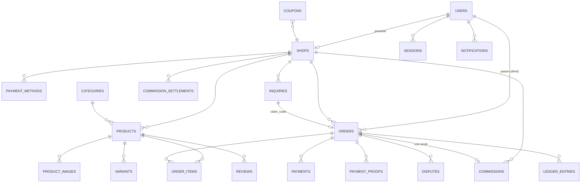

# Schéma de la base de données

26 tables, SQLAlchemy 2, migrations Alembic (`migrations/versions/dbed8e9e46fe_initial_schema.py`). Compatible SQLite (dev) et PostgreSQL (prod).

## 1. Vue d'ensemble (Mermaid)



## 2. Tables et colonnes clés

| Table | Rôle | Colonnes importantes / contraintes |
|---|---|---|
| `users` | Comptes | `id`, `email` UNIQUE, `phone_e164` UNIQUE, `password_hash` (PBKDF2), `role` CHECK(admin/vendor/customer), `phone_verified`, `failed_logins`, `locked_until`. |
| `otp_codes` | Vérification téléphone | `code_hash` (jamais en clair), `expires_at`, `attempts ≤ 5`, `consumed_at`. |
| `sessions` | Sessions | `id` = SHA-256 du jeton, `csrf_token`, `expires_at`, `ip`, `user_agent`. Cookie HttpOnly. |
| `shops` | Boutiques | `owner_id` UNIQUE, `slug` UNIQUE, `whatsapp_e164`, `status`, `commission_bps_override` (admin), `risk_score`, `view_count`. |
| `payment_methods` | Comptes déclarés | `shop_id`, `provider`, `phone_e164`, `account_ref`, `routing` (platform/merchant_direct), `is_verified`. |
| `categories` | Taxonomie | `slug` UNIQUE, `parent_id` auto-référence. |
| `products` | Catalogue | `shop_id`, `slug`, `title`, `price_xof` INT, `stock`, `delivery_fee_xof`, `status`, `attributes_json`. `UNIQUE(shop_id, slug)`, CHECK montants ≥ 0. |
| `product_images`, `variants` | Médias et déclinaisons | URL WebP locale, `position`, `price_delta_xof`. |
| `favorites`, `reviews` | Engagement | `reviews` : `UNIQUE(product_id, order_id, user_id)`, note 1–5, achat payé requis. |
| `inquiries` | Clics WhatsApp | `claim_code` UNIQUE, `ip_hash`, `session_hash`, `order_id` (lien après déclaration), `source`. |
| `orders` | Commandes | `reference` UNIQUE, `shop_id`, `customer_*`, `subtotal_xof`, `discount_xof`, `delivery_fee_xof`, `total_xof`, `status`, `payment_status`, `origin`, `claim_code`, `idempotency_key` UNIQUE, `risk_score`, `version`. |
| `order_items` | Lignes | `title_snapshot`, `unit_price_xof` recalculé serveur, `quantity`, `line_total_xof`. |
| `payments` | Paiements vérifiés | `provider`, `provider_reference`, `verification` (webhook:wave / admin:proof…), `verified_by`, `verified_at`, `UNIQUE(provider, provider_reference)`. |
| `payment_proofs` | Preuves | `status` (pending/accepted/rejected), `reviewed_by`, `review_note`, référence unique contrôlée. |
| `webhook_events` | Anti-rejeu | `UNIQUE(provider, event_id)`, `signature_valid`, `status`, `error`. |
| `commissions` | **Une par vente** | `order_id` UNIQUE, `gross_xof`, `rate_bps` figé, `platform_fee_xof`, `payment_fee_xof`, `net_vendor_xof`, `status`, `paid_at`, `reversed_at`. |
| `ledger_entries` | Journal financier | `id` auto, `entry_type`, `account`, `amount_xof` SIGNÉ, `debit_xof`/`credit_xof`, `prev_hash`, `entry_hash` UNIQUE. **Triggers interdisant UPDATE/DELETE.** |
| `commission_settlements` | Encaissements | `shop_id`, `amount_xof`, `method`, `reference`, `recorded_by`. |
| `notifications` | Centre de notifications | `user_id`, `kind`, `title`, `body`, `link`, `dedupe_key`. |
| `audit_logs` | Audit | `actor_id`, `action`, `before_json`, `after_json`, `ip`, `prev_hash`, `entry_hash`. **Append-only.** |
| `platform_settings` | Paramètres admin | `key`, `value_json` (JSON), `updated_by`, `updated_at`. |
| `coupons`, `disputes` | Promotions, litiges | Moteur de remise et instruction des litiges. |

## 3. Index principaux

`users(email, phone_e164, role, created_at)` · `shops(slug, owner_id, status, created_at)` ·
`products(shop_id+status, category_id, price_xof, title, slug, created_at)` ·
`orders(reference, shop_id, status, payment_status, customer_phone, created_at)` ·
`commissions(order_id UNIQUE, shop_id, status, calculated_at)` ·
`ledger_entries(account, entry_type, order_id, shop_id, created_at)` ·
`inquiries(claim_code, shop_id, created_at)` · `webhook_events(provider+event_id UNIQUE)`.

## 4. Isolation multi-vendeurs

Chaque table métier porte `shop_id`. Toute requête vendeur passe par `_shop(db, user)` puis filtre sur ce `shop_id`. Les contrôles :
- `orders.order_for_vendor()` refuse une commande d'une autre boutique ;
- `/api/vendor/*` dérive systématiquement la boutique de l'utilisateur connecté ;
- `/api/admin/*` exige le rôle admin via `api_admin` ;
- aucune route n'accepte un `shop_id` fourni par le client pour une lecture vendeur.

## 5. Comptes logiques du journal

| Compte | Signification |
|---|---|
| `gmv` | Chiffre d'affaires net (ventes − remboursements). |
| `platform_revenue` | Commissions reconnues (net des reversements). |
| `commission_receivable` | Créance sur les vendeurs, diminuée à l'encaissement. |
| `cash` | Encaissements réels, diminués en cas de remboursement après règlement. |
| `vendor_payable` | Montant dû aux vendeurs. |
| `payment_expense` | Frais PSP. |
| `delivery_payable` | Frais de livraison à reverser (non commissionnés). |

## 6. Migrations

```bash
python -m alembic upgrade head          # applique le schéma
python -m alembic revision --autogenerate -m "description"
python -m alembic downgrade -1          # retour arrière (déconseillé en prod : restaurer une sauvegarde)
```

La migration initiale crée les 26 tables, les index, les contraintes CHECK/UNIQUE et les triggers d'immutabilité (variantes SQLite et PostgreSQL). `app/seed.init_db()` peut recréer le schéma en dev, mais **en production seule Alembic fait autorité**.
